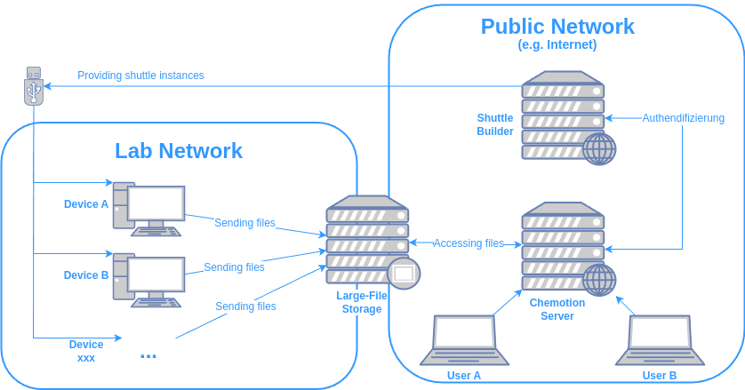

# ShuttleBuilder

Full documentation: [Chemotion docs, data transfer](https://chemotion.net/docs/eln/devices/configurations/data_transfer)
(self-contained lab-staff version in this repository: [docs/chemotion-data-transfer.md](docs/chemotion-data-transfer.md)).

## What ShuttleBuilder is

ShuttleBuilder is a Django application that builds [Shuttle](https://github.com/ComPlat/shuttle) for each lab and serves it as a download.
Shuttle is a small Go program that watches a folder on a lab PC and uploads new data via WebDAV or SFTP to an intermediate storage, from where the Electronic Lab Notebook (ELN) Chemotion collects it. A third transfer type, ChemAssistent, uploads to a ChemAssistentManager job instead (see [ChemAssistent upload](#chemassistent-upload)).

The application works independently of Chemotion but is designed to operate as a service for it. Users log in with their Chemotion password and abbreviation; superusers can also create local users in the [admin](/admin/).



Lab PCs are physically separated from public networks for security reasons, so data must be forwarded to the ELN through an intermediary system. Shuttle is one part of it: it sends device data to the intermediate storage. Each Shuttle is built for its lab (source folder, destination, credentials, security options), so installing it takes only a few steps.

**Contents:** [Install](#install-shuttle) | [After the installation](#what-shuttle-does-after-the-installation) | [Security](#security) | [Windows XP](#windows-xp) | [Preprocess scripts](#preprocess-scripts) | [Admins](#admins) | [Chemotion docs](#chemotion-docs)

---

## Install Shuttle

Supported: Windows x64 and i386 (including Windows XP) and Linux x64. Installing needs administrative rights.

1. **Create the instance.** In the Shuttle list click the new-instance button and fill in the [Shuttle instance form](/shuttle-instance-list/shuttle-instance-edit) for your WebDAV or SFTP server (or for a ChemAssistentManager job).
2. **Download it** from the Shuttle list. Depending on the options you get a single executable or a zip file. Every zip contains an `INSTALL.txt` with the steps for exactly this instance (it never contains passwords, users or host keys).
3. **Install it** as described below.

### Windows (64 bit and i386)

1. Create the folder `C:\Program Files\Shuttle`.
2. Copy `shuttle.exe` into it (for a zip: all files except `INSTALL.txt`).
3. Download [shuttle_task.vbs](/sdc_view/main_app/download/shuttle_task.vbs) (also linked in the app's documentation page and in `INSTALL.txt`) and copy it into the startup folder: press **Windows key + R**, type `shell:startup`, press Enter.
4. Restart the computer, or double-click `shuttle_task.vbs` once.

The `.vbs` file starts `C:\Program Files\Shuttle\shuttle.exe` hidden at every login.

### Windows XP with SFTP

Use the zip `shuttle_sftp_winxp.zip`. It contains `shuttle.exe` and a portable WinSCP. Install it like Windows above, but copy **all** files (`shuttle.exe`, `WinSCP.exe`, `WinSCP.com`, `license.txt`) into `C:\Program Files\Shuttle`. WinSCP must stay next to `shuttle.exe`. See [Windows XP](#windows-xp).

### Linux

Shuttle is installed as a **systemd** service, one unit per instance.

1. Set the field *Linux user* of the instance: the user whose home folder holds the working folder.
2. Create `/opt/Shuttle` and copy `shuttle` into it (for a zip: all files except `INSTALL.txt`). Make the programs executable (`chmod +x /opt/Shuttle/shuttle`, and `/opt/Shuttle/ChemConverterApp` if the instance has a converter).
3. Click the **systemd unit** button of the instance in the Shuttle list and save the file as `/etc/systemd/system/shuttle.service`. (Generic fallback: `/sdc_view/main_app/download/shuttle.service`.) If it contains `User=CHANGE_ME`, replace `CHANGE_ME` with the Linux user.
4. Run:
   ```bash
   systemctl daemon-reload
   systemctl enable --now shuttle.service
   ```

---

## What Shuttle does after the installation

**Working folder.** Shuttle creates `~/shuttle/shuttle_<name>/` (Windows: `%USERPROFILE%\shuttle\shuttle_<name>\`), where `<name>` is the instance name. It holds:

- `shuttle_log.txt`, the log (the first place to look when something does not work);
- `sent_register.json`, the list of files already handed over (path relative to the source folder, modification time and size);
- `known_hosts` (SFTP only, see [Security](#security)).

**What gets sent.**

- A file is sent when it is new or has changed since it was last sent, has not been modified for the configured *duration*, and is not locked by another program.
- Folder-based transfer types (folder, zip, tar): a folder is sent when at least one of its files is new or changed and all of its files have been unchanged for the duration. **A changed folder is always sent again completely.**
- **First start:** every stable file already in the source folder (older than the duration) is sent **once**. Plan for the traffic, and for duplicates on the server if the data was already transferred another way. The same happens when the register is empty or missing.
- **Resend everything:** stop Shuttle, delete `sent_register.json`, start Shuttle. A damaged register is moved aside as `sent_register.json.corrupt-<time>` and Shuttle starts with an empty one.

**Outages.** Network problems are never fatal. If the server cannot be reached (also at boot, before the network is up) the error is logged and the upload is retried with increasing waits (up to the duration). Files stay in the working folders until the server confirmed the upload.

**Stopping.** On Linux systemd stops Shuttle cleanly (SIGTERM); files not yet sent are sent after the next start. Shuttle exits on configuration errors (e.g. an unreadable `~/shuttle/scripts` folder, or a missing `ChemConverterApp` when the converter is enabled); the reason is in the log.

---

## Security

Each instance has three optional settings that control how the server is verified.

### WebDAV and ChemAssistent: server certificate

Shuttle checks the server certificate with the system root certificates plus an optional certificate file. A server with a **self-signed or private certificate** needs that certificate (or its CA) as the instance's *server certificate* (PEM); this works the same for WebDAV and ChemAssistent. Without it, uploads fail until it is set; files wait and are sent once the connection works.

The certificate is shipped as `server.crt` next to the executable, so the download becomes a zip file. **Keep `server.crt` next to `shuttle.exe` / `shuttle`**: Shuttle looks for it there first. If the certificate was added after you installed Shuttle, download the zip again and replace the files. An unreadable certificate file is logged as a warning.

### SFTP: SSH host key

- **Pinned:** enter the server's fingerprint as *SSH host key* (`SHA256:...`, optionally with the WinSCP prefix such as `ssh-ed25519 255 SHA256:...`, or `MD5:aa:bb:...`). Shuttle then only connects to a server presenting exactly this key. Get the fingerprint in WinSCP (*Session > Server/Protocol Information*) or with `ssh-keyscan -p <port> <host> | ssh-keygen -lf -` (use the `SHA256:...` value). The host key applies to both SFTP destinations (main and converter), so they must be the same server.
- **Trust on first use (no host key entered):** Shuttle trusts the key it sees on the first connection and stores it in `known_hosts` in the working folder. If the server later presents a different key, Shuttle refuses to connect and logs which key it saw. If the change is intended (for example a reinstalled server), delete the server's line from `known_hosts`, or set the *SSH host key*.

### Disable verification (`insecure`)

Switches off TLS and SSH host key verification and logs a warning. Any user can set it. The instance list marks such instances with a red "Verification disabled" badge; SFTP instances without a host key show a "No host key" hint. Use it only for tests.

---

## ChemAssistent upload

The transfer type **ChemAssistent job (HTTP upload)** sends each file (or each folder) to a ChemAssistentManager job by HTTP POST. Every upload starts **one run** of the job's AI agent, which gets the files as input.

1. In ChemAssistentManager create a job with the trigger **"HTTP file upload (API key)"** and create an **API key** for it. The key is shown only once.
2. In ShuttleBuilder create the Shuttle instance with the transfer type *ChemAssistent job (HTTP upload)*. Enter the server URL as *destination* and the key (starts with `cam_`) in the *API key* field (stored in the instance's `password` field). The user and the SSH host key are not used. If the administrator configured `CHEMASSISTENT_URL`, the form pre-fills the destination and links to ChemAssistentManager.
3. Download and install the Shuttle as usual.

- **Destination:** `http://` or `https://` with a host. Without a path (or with `/`) `/api/jobs/trigger` is appended; any other path is used as the full trigger URL.
- **Runs per Shuttle type:** `file` and `flat_tar`: one run per file. `zip` and `tar`: one run per archive. `folder`: one run per folder with all its files; folder paths are flattened into the file names (`A/B/x.csv` becomes `A__B__x.csv`).
- **Size limit:** uploads larger than 100 MB are not attempted and stay local.
- **Local files:** a file is deleted locally only after the server confirmed the upload (`202`).
- **Revoked key or disabled job:** the files stay local and are sent when the problem is fixed. After a revoked key, give the instance a new key, build it and download it again, then replace the Shuttle on the PC.
- **TLS:** the server certificate and *insecure* work as for WebDAV. Windows XP builds speak at most TLS 1.2, so the server must offer TLS 1.2.
- **Not supported:** the converter (`ChemConverterApp`) cannot be combined with this transfer type.
- **Zip or single file:** the download is the plain executable; with a server certificate it is a zip with `server.crt` and `INSTALL.txt` (no WinSCP).
- The API key is never written to the Shuttle log or to `INSTALL.txt`.

---

## Windows XP

- XP builds are compiled with Go 1.10.8.
- **SFTP:** WinSCP is used for the transfer. `WinSCP.com` (and `WinSCP.exe`) must be in the same folder as `shuttle.exe`; the zip contains them. Shuttle writes a short temporary script into its working folder, runs `WinSCP.com` once per uploaded file and deletes the script afterwards. The password is not written to the log. At startup a connection check runs, so a missing `WinSCP.com` or a rejected host key shows up in the log immediately.
- **Host key:** the host key is required for XP with SFTP (unless verification is disabled). It is compiled into `shuttle.exe`. Without a host key WinSCP must already know the server's key (connect once with WinSCP on that PC and accept it), otherwise every upload fails; Shuttle logs a note at startup.
- **WebDAV / TLS:** the XP build cannot read the Windows certificate store, so it verifies the server certificate **only** when the server certificate (`server.crt`) is set. Without it, verification is off and a warning is logged at startup.
- **Not yet tested on real hardware:** SFTP on a real Windows XP machine is still an open manual test (tracked as a Shuttle issue). Test it on your PC before relying on it.

---

## Preprocess scripts

Scripts in `~/shuttle/scripts` (Windows: `%USERPROFILE%\shuttle\scripts`) run before each file is sent. They get one argument, the absolute path of the file, and may overwrite it or write a new copy in the same folder.

- Windows: only regular files with the extension `.exe` (any case) run; `.bat`, `.cmd` and `.sh` do not.
- Linux: every regular file with an execute bit runs, whatever its extension (a symlink to such a file too).
- Directories and hidden files (names starting with `.`) never run.
- A failing script or converter is logged; the conversion is skipped and the raw data is still sent.

---

## Admins

### Set up ShuttleBuilder

Use the Docker image [mstarman/shuttlebuilder](https://hub.docker.com/r/mstarman/shuttlebuilder). Environment variables:

```
MODE=prod
# The host URL via which the service can be accessed
ALLOWED_HOST=http://0.0.0.0
# The Chemotion URL, only needed if you want to mirror the user management
ELN_URL=https://eln.example.org
# Initial superuser
DJANGO_SUPERUSER_USERNAME=admin
DJANGO_SUPERUSER_EMAIL=admin@example.org
DJANGO_SUPERUSER_PASSWORD=<choose-a-strong-password>
# Database
POSTGRES_DB=builder
POSTGRES_USER=postgres
POSTGRES_PASSWORD=<choose-a-strong-password>
POSTGRES_PORT=5432
POSTGRES_HOST=db
```

### Toolchains

The image contains two Go toolchains: Go 1.26.11 (`GOROOT=/usr/local/go`, on `PATH`) for all modern targets, and Go 1.10.8 for Windows XP (`XP_GOROOT=/usr/local/go1.10.8`, not on `PATH`; used in GOPATH mode). Both are pinned in the `Dockerfile` (`GO_VERSION`, `XP_GO_VERSION`, with checksums).

### Rolling out a new Shuttle version

1. In the git instance list, **reload** the active `GitInstance` (or activate another one). This clones the repository again; the Shuttle version of the checkout (`shuttle_version`, read from `main.go`) is shown in the list.
2. Every Shuttle instance is rebuilt on its next download. The Shuttle list shows the version each instance was last built with (`built_version`, "not built yet" otherwise); `INSTALL.txt` names it too.
3. Labs download their zip again, replace the executable and restart Shuttle (Windows: end the running `shuttle.exe` in the Task Manager, replace the file, then restart the PC or double-click `shuttle_task.vbs`; Linux: replace the file, then `systemctl restart shuttle.service`).

Announce the rollout first: **after an update from Shuttle 1.12 or older, the first start sends every stable file in the source folder once** (later updates keep `sent_register.json`) (see [docs/announcement-shuttle-1.14.md](docs/announcement-shuttle-1.14.md)).

### Smoke build and CI

- `python manage.py shuttle_smoke_build` (inside the image, throw-away SQLite database) builds Shuttle for all six architectures and checks the results. `dev/smoke_build.sh <image>` runs it in a Docker image: `dev/smoke_build.sh -h` shows the options.
- GitHub Actions: `.github/workflows/ci.yml` runs the tests; `.github/workflows/smoke.yml` runs the smoke build against Shuttle `main`.
- `deploy.sh` builds the image, runs the smoke build and only deploys when it passes.

---

## Chemotion docs

- [Chemotion docs: data transfer](https://chemotion.net/docs/eln/devices/configurations/data_transfer)
- [Lab-staff version in this repository](docs/chemotion-data-transfer.md)
- [Announcement for Shuttle 1.14](docs/announcement-shuttle-1.14.md)
- [Shuttle on GitHub](https://github.com/ComPlat/shuttle)
